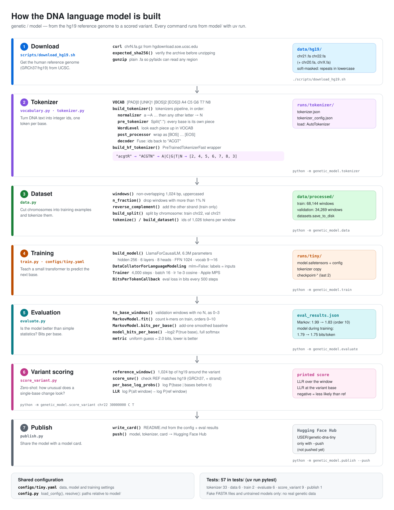

# docs

Notes and learnings from each phase of the project: concepts, decisions, experiments and results.

## Model pipeline

How the DNA language model in [`model/`](../model/) is built, from download to variant scoring: files, methods and outputs of each phase.

